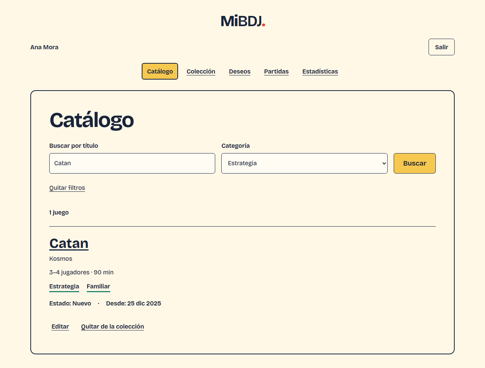
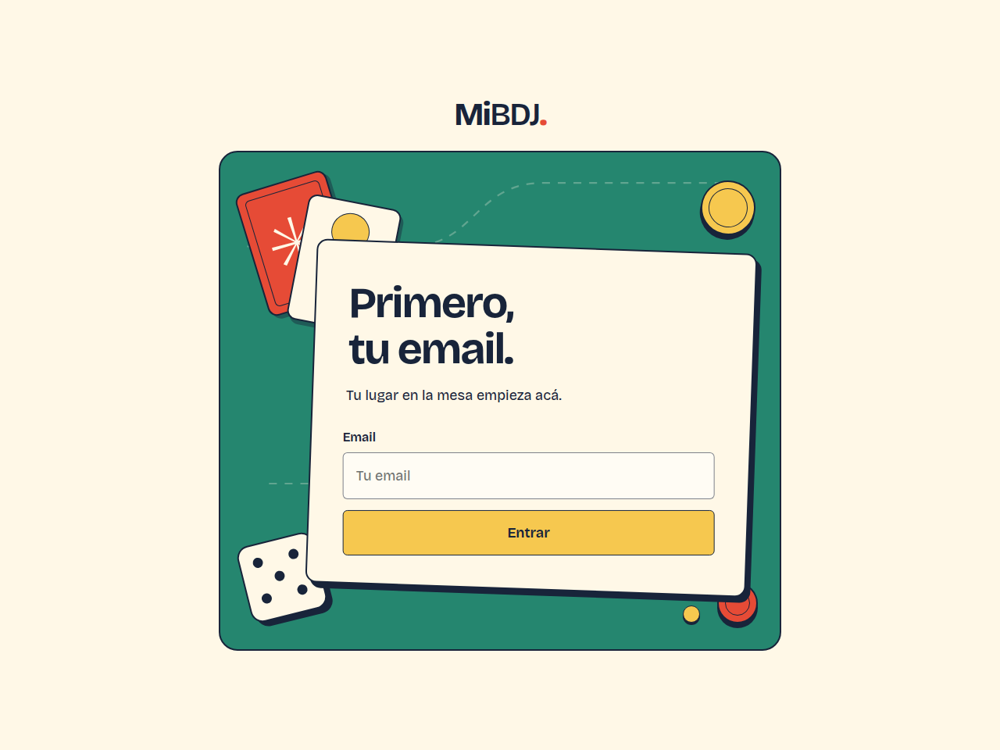
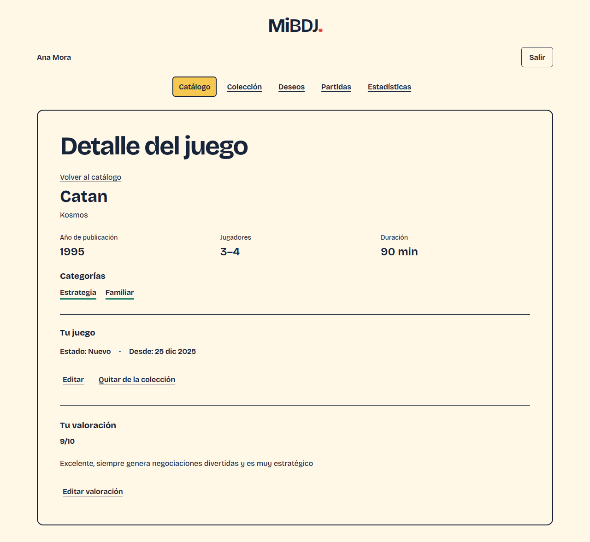
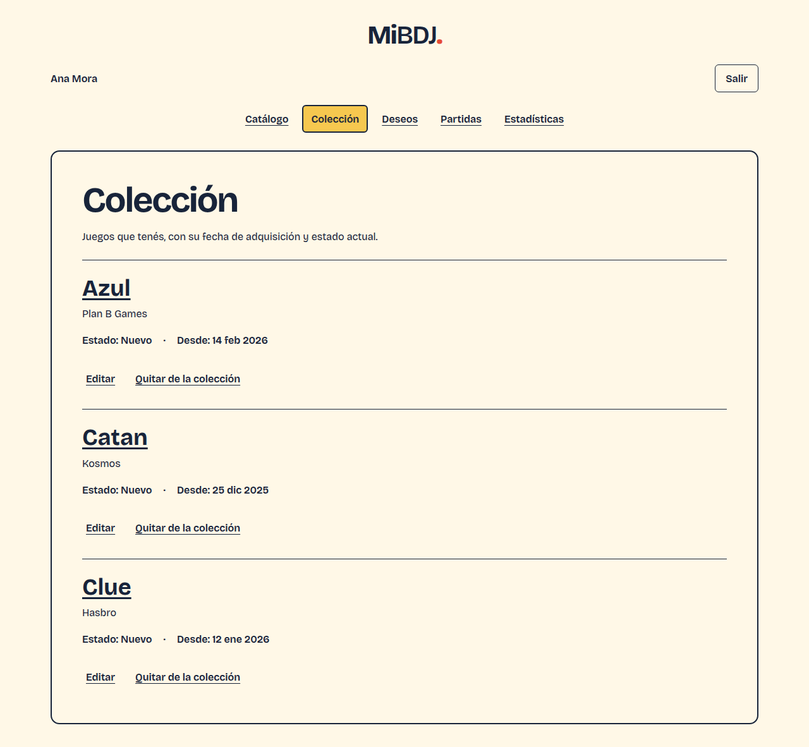
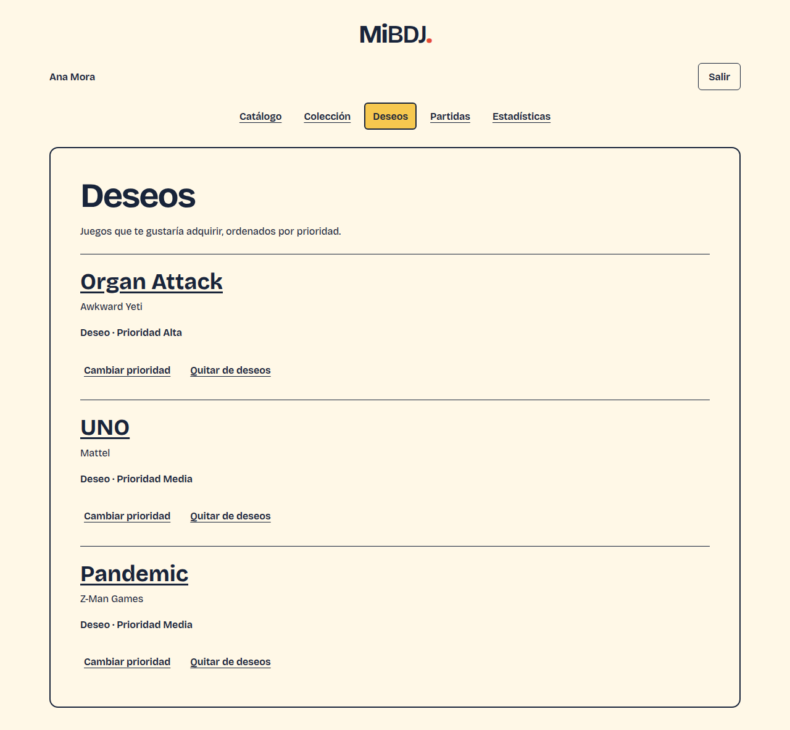
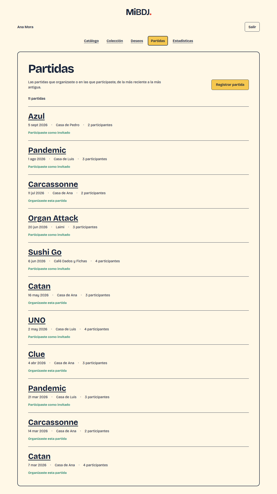
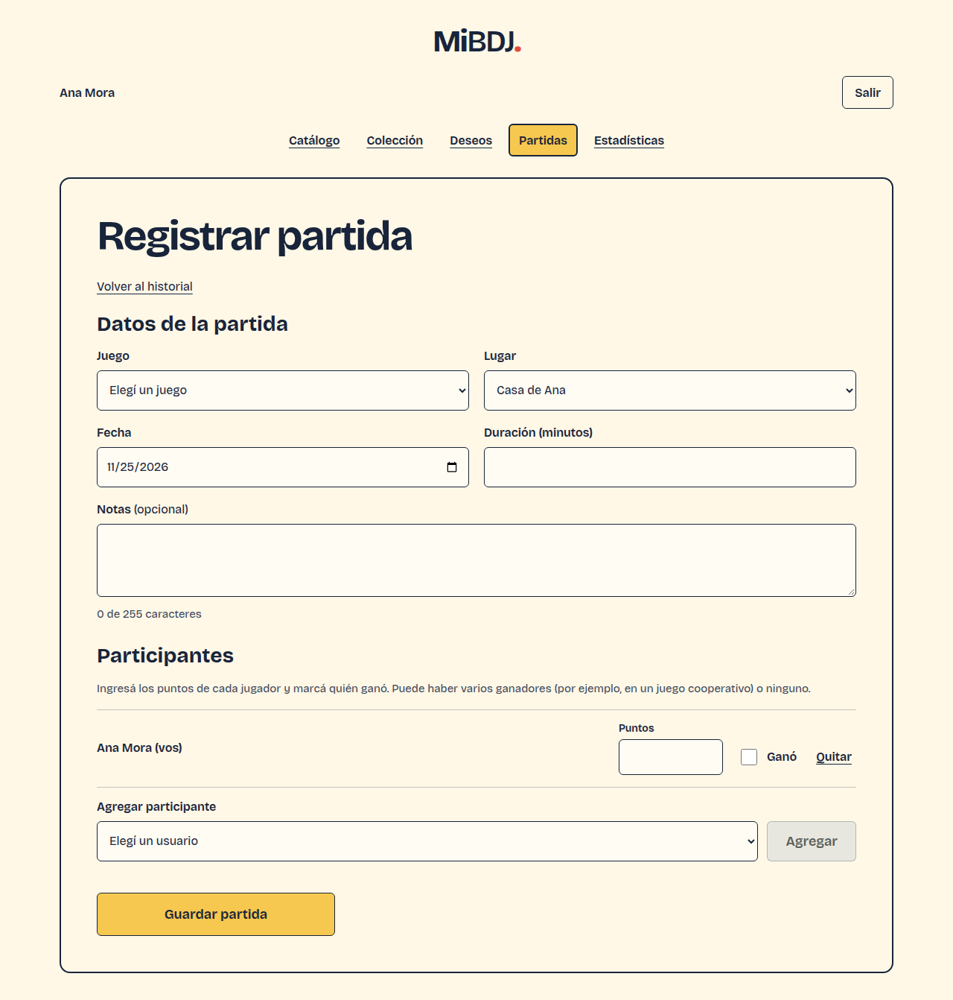
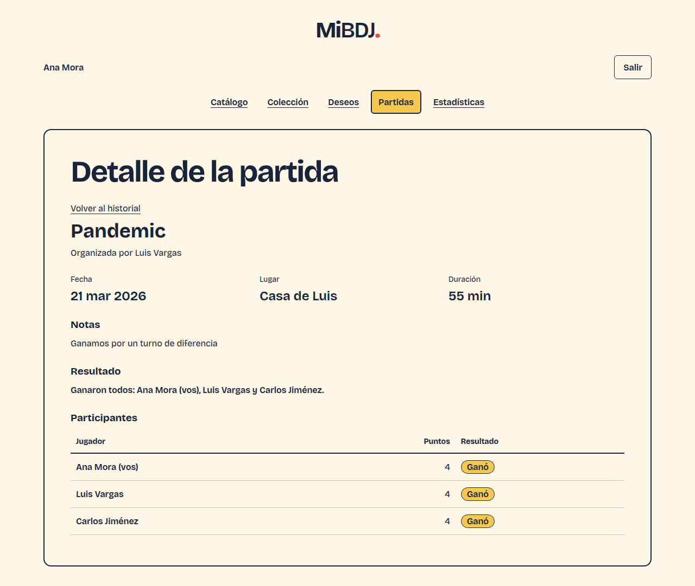
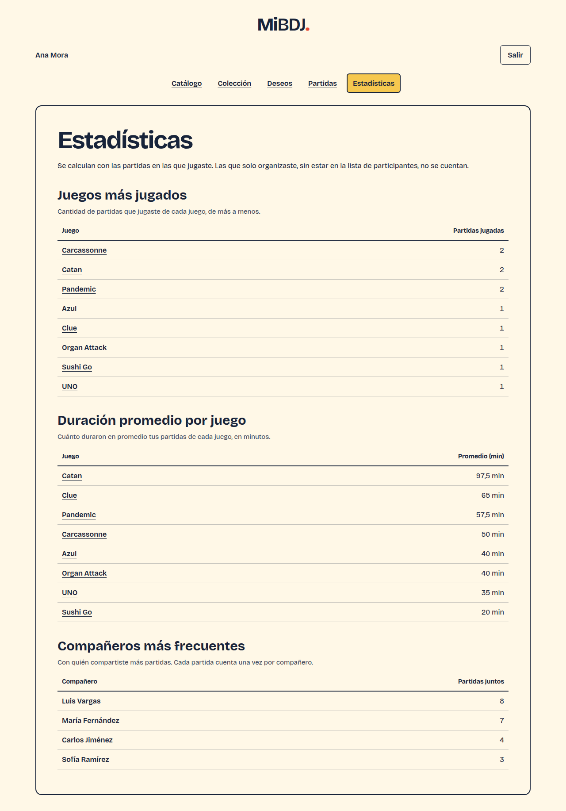

<div align="center">

<h1>MiBDJ</h1>
<p>Mi base de datos de juegos de mesa</p>
<p><strong>Frontend · React · TypeScript · Vite</strong></p>

[Configurar el proyecto](docs/setup.md) · [Ver las pantallas](#pantallas) · [Ver el backend](https://github.com/rgdan/mibdj-backend)

</div>

---

Un catálogo de juegos de mesa con colección personal, lista de deseos y
valoraciones. Registrá partidas con participantes, puntos y ganadores;
consultá el historial y las estadísticas de cada usuario.

[Inicio local](#inicio-local) · [Pantallas](#pantallas) · [Estructura](#estructura)

## Inicio local

[Instalar, configurar la API y arrancar el frontend](docs/setup.md).

Con el backend activo, entrá con el email de un usuario precargado, como
`ana.mora@gmail.com`. No se pide contraseña. `Salir` limpia el usuario activo;
al recargar la página hay que volver a entrar.

## Pantallas

Capturas reales en escritorio, con los datos de ejemplo del backend y el
perfil de Ana Mora. Cada imagen se puede abrir en su tamaño original.

### Catálogo

Búsqueda por título y categoría, detalle de juegos y acciones de colección y deseos.



<details>
<summary>Acceso por email</summary>



</details>

<details>
<summary>Detalle del juego y valoración personal</summary>



</details>

<details>
<summary>Colección personal</summary>



</details>

<details>
<summary>Lista de deseos</summary>



</details>

<details>
<summary>Historial de partidas</summary>



</details>

<details>
<summary>Registro de una partida</summary>



</details>

<details>
<summary>Detalle de una partida</summary>



</details>

<details>
<summary>Estadísticas</summary>



</details>

## Estructura

Cada funcionalidad agrupa sus pantallas, tipos y llamadas a la API.

```text
src/
├── App.tsx         Navegación y usuario activo
├── main.tsx        Entrada de la aplicación
├── styles.css      Estilos compartidos
├── api/            Cliente HTTP y URL del backend
├── auth/           Acceso por email
├── catalog/        Catálogo y detalle de juegos
├── collection/     Colección personal
├── wishlist/       Lista de deseos
├── ratings/        Valoración y comentario
├── matches/        Registro, historial y detalle de partidas
├── stats/          Estadísticas por usuario
└── shared/         Funciones de fechas
```

Los endpoints y sus contratos están en la [referencia de la API del backend](https://github.com/rgdan/mibdj-backend/blob/main/docs/api.md).
